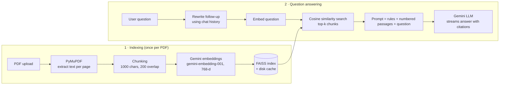

# 📄 DocChat — Chat with your PDFs using RAG and Google Gemini

DocChat is a Generative AI web app that lets you upload PDF documents and ask questions about them in plain language.
It uses **Retrieval-Augmented Generation (RAG)**: instead of letting the LLM answer from memory (and hallucinate),
the app first **retrieves** the most relevant passages from your PDFs and gives them to the LLM, which then writes an
answer **grounded in your documents, with page citations**.

## ✨ Features

- Upload **multiple PDFs** and choose which ones to search
- Answers **cite their sources** (`[1]`, `[2]`) with file name, page number, passage text and similarity score
- **Conversational memory**: follow-up questions like *"what about its cost?"* are rewritten into standalone questions before searching
- **Automatic summary** and **suggested questions** for every uploaded document
- **Streaming** answers (typing effect)
- Built-in **page viewer** for each document
- **Embedding cache**: each PDF is embedded only once, even after a restart
- Adjustable **top-k, temperature and chunk size**, plus **chat export** to Markdown
- Friendly handling of invalid keys, rate limits, and scanned (image-only) PDFs

## 🏗️ Architecture



| Layer | Technology |
|---|---|
| UI | Streamlit |
| PDF parsing | PyMuPDF |
| Embeddings | Google `gemini-embedding-001` (768 dimensions) |
| Vector store | FAISS (`IndexFlatIP` on normalised vectors = cosine similarity) |
| LLM | Google Gemini (selectable: `gemini-3.6-flash`, `gemini-3.1-flash-lite`, `gemini-2.5-flash`) |
| SDK | `google-genai` |

### Project structure

```
docchat/
├── app.py                  # Streamlit UI: upload, chat, documents tab
├── rag/
│   ├── pdf_utils.py        # PDF -> text -> overlapping chunks (with page numbers)
│   ├── vector_store.py     # FAISS index + on-disk embedding cache
│   ├── llm.py              # Gemini client: embeddings, generation, retries
│   ├── pipeline.py         # RAG steps: index, rewrite, retrieve, answer, summarise
│   └── prompts.py          # all prompts in one place
├── .streamlit/
│   ├── config.toml
│   └── secrets.toml.example
└── requirements.txt
```

## 🚀 Setup (about 5 minutes)

**1. Get a free Gemini API key** at <https://aistudio.google.com/apikey>.

**2. Install** (Python 3.10 or newer):

```bash
cd docchat
python -m venv venv
# Windows:      venv\Scripts\activate
# macOS/Linux:  source venv/bin/activate
pip install -r requirements.txt
```

**3. Add your key.** Either paste it into the sidebar when the app opens, or copy
`.streamlit/secrets.toml.example` to `.streamlit/secrets.toml` and put your key there.

**4. Run:**

```bash
streamlit run app.py
```

The app opens at <http://localhost:8501>.

### Deploy for free (optional)

Push the folder to GitHub, then go to <https://share.streamlit.io>, choose the repo, and set `app.py` as the entry point.
Under **Settings → Secrets**, add `GEMINI_API_KEY = "..."`.

## 🧠 How RAG works here (key concepts)

- **Chunking:** LLMs and embedding models work best on short passages. Each page is split into ~1000-character chunks
  with a 200-character overlap, so a sentence on a boundary isn't lost. Chunks keep their page number for citations.
- **Embeddings:** an embedding model maps text to a vector, so texts with similar meaning end up close together.
  Documents use `task_type=RETRIEVAL_DOCUMENT` and questions use `RETRIEVAL_QUERY`, which Gemini optimises for search.
- **Vector search:** vectors are L2-normalised, so FAISS inner product = **cosine similarity**. The top-k chunks are retrieved.
- **Grounded generation:** the system prompt tells the LLM to answer *only* from the numbered passages, cite them,
  and say so if the answer isn't there. This reduces hallucination.
- **Query rewriting:** a follow-up question is rewritten into a standalone question using recent chat history, so retrieval still works mid-conversation.

## ⚠️ Limitations and future work

- Scanned PDFs (images only) have no extractable text. OCR could be added.
- Tables and figures are read as plain text only.
- Possible extensions: hybrid search (BM25 + vectors), re-ranking, evaluation with a question/answer test set, support for DOCX/web pages.

## 🙏 Credits and license

This project is based on [kavehbc/chat-pdf](https://github.com/kavehbc/chat-pdf) by Kaveh Bakhtiyari (GPL-3.0).
Changes made in this version:

- Replaced MongoDB Atlas with a local FAISS vector store, so no database setup is needed
- Fixed PDFs being re-embedded on every message; added a persistent embedding cache
- Migrated from deprecated LangChain chains to the official `google-genai` SDK, with a fully visible RAG pipeline
- Added page-level citations, query rewriting for follow-ups, document summaries, suggested questions,
  streaming, page viewer, settings, chat export and error handling

Licensed under GPL-3.0 (see `LICENSE`), as required by the original project.
